<div align="center">

<a href="https://github.com/ishandutta2007/Awesome-Awesome-Awesome"></a><a href="https://discord.gg/jc4xtF58Ve"></a>
[](https://opensource.org/licenses/MIT)
[](https://github.com/ishandutta2007/Awesome-3D-Texturing-Modeling-Suite/pulls)
[](https://github.com/ishandutta2007/Awesome-3D-Texturing-Modeling-Suite/graphs/commit-activity)
<a href="https://github.com/ishandutta2007"></a>

<br/><br/>



# 🎨 Awesome 3D Texturing &amp; Modeling Suite 🖌️

### 🚀 Top Integrated 3D Pipelines, Creative Ecosystems &amp; Self-Hosted Open-Source Suites

*A hand-curated index of industry-standard SaaS platforms, all-in-one digital content creation (DCC) suites, and high-performance open-source 3D repositories.*

**📅 Last updated: October 2026**

</div>

---

## 📌 Overview

This repository tracks top-tier **SaaS platforms** and **open-source projects** powering the **3D Texturing & Modeling Ecosystem**. From photorealistic PBR material painting and polygonal sculpting to procedural node graphs and real-time ray-tracing viewports, these suites combine multiple stages of the 3D pipeline into cohesive, production-ready workflows.

- 💎 **Commercial Industry Leaders**: [Adobe Substance 3D Collection](https://www.adobe.com/products/substance3d/collection.html), [Autodesk Maya](https://www.autodesk.com/products/maya/), [Maxon One](https://www.maxon.net/en/maxon-one), [Unreal Engine](https://www.unrealengine.com/), and [Unity](https://unity.com/).
- 🌐 **Free & Open-Source Standouts**: Anchored by [Blender](https://github.com/blender/blender), with specialized node texturing in [Material Maker](https://github.com/RodZill4/material-maker), 3D brush painting in [ArmorPaint](https://github.com/armory3d/armorpaint), and parametric design via [FreeCAD](https://github.com/FreeCAD/FreeCAD).

---

## 📑 Table of Contents

- [📊 Sector Overview & Market Dynamics](#-sector-overview--market-dynamics)
- [💼 SaaS & Commercial Hosted Platforms](#-saas--commercial-hosted-platforms)
- [🌟 Open-Source GitHub Projects](#-open-source-github-projects)
  - [Top Repositories (Ranked by Stars)](#top-repositories-ranked-by-stars)
  - [Recommended Open-Source Pipeline](#recommended-open-source-pipeline)
- [🤝 How to Contribute](#-how-to-contribute)
- [💖 Support](#-support)
- [⭐ Star History](#-star-history)
- [⚖️ Disclaimer](#️-disclaimer)

---

## 📊 Sector Overview & Market Dynamics

The global 3D modeling and texturing software market is valued at approximately **$8.6B to $9.6B in 2026** (expanding to over $35B when factoring in real-time game engines, animation, and enterprise VFX pipelines) with a compound annual growth rate (CAGR) of ~14%. 

The sector is **moderately concentrated to oligopolistic**, dominated by an entrenched group of mega-cap creative and engineering suites (Adobe, Autodesk, Epic Games, Nemetschek/Maxon) creating deep ecosystem lock-in through proprietary pipeline tooling, counterbalanced by Blender's rapidly accelerating open-source adoption across both indie and AAA production studios.

---

## 💼 SaaS & Commercial Hosted Platforms

| 🏷️ Product | 🏢 Company Valuation / Revenue | 📝 Description | 💳 Starting Tier Pricing | 🎁 Free Tier / Trial Limit |
| :--- | :--- | :--- | :--- | :--- |
| **[Adobe Substance 3D Collection](https://www.adobe.com/products/substance3d/collection.html)** | ~$104B Market Cap *(Adobe NASDAQ: ADBE)* | Integrated suite of Modeler, Sampler, Designer, Painter, Stager, and 3D Assets for end-to-end PBR material creation. | **$49.99/mo** (billed annually at $599.88/yr) or **$59.99/mo** (month-to-month); Teams tier at **$119.99/mo** per seat. | **30-day free trial** with full access to all apps and 100 GB cloud storage; no permanent free plan. |
| **[Autodesk Maya](https://www.autodesk.com/products/maya/)** | ~$53B Market Cap *(Autodesk NASDAQ: ADSK)* | Industry-standard 3D modeling, rigging, simulation, animation, and rendering suite. | **$255/mo** (month-to-month) or **$2,010/yr** upfront; Maya Indie available at **$330/yr** for artists earning <$100k/yr. | **30-day free trial** with full unrestricted feature access on 1 device; permanent free access restricted to verified students/educators. |
| **[Unreal Engine (Epic)](https://www.unrealengine.com/)** | ~$22.5B Valuation *(Epic Games, Private)* | Real-time 3D creation platform with integrated modeling, texturing, Nanite geometry, and Lumen rendering. | **Free** for game creators (5% royalty only after $1M lifetime gross revenue); **$1,850/seat/yr** for commercial non-game applications (revenue >$1M). | **Free forever plan** for game developers, students, educators, hobbyists, and all commercial businesses generating under $1M annual gross revenue. |
| **[Unity](https://unity.com/)** | ~$19B Market Cap *(Unity Software NYSE: U)* | Real-time 3D engine with integrated modeling, material graphs, Shader Graph, and multiplatform rendering. | **Unity Pro**: **$210/mo** or **$2,310/yr** per seat; Unity Enterprise custom pricing for large studios. | **Unity Personal (Free forever)**: Complete engine access for individuals and businesses with under $200k in annual gross revenue/funding. |
| **[Maxon One](https://www.maxon.net/en/maxon-one)** | ~$9.5B Market Cap *(Parent Nemetschek Group ETR: NEM)* | Comprehensive creative suite bundling Cinema 4D, ZBrush, Redshift, Red Giant, Universe, and Forger. | **$149/mo** (month-to-month) or **$1,199/yr** (billed annually upfront). | **14-day free trial** with full ecosystem access via Maxon App for 1 user/device; no permanent free plan. |
| **[Cinema 4D (Maxon)](https://www.maxon.net/en/cinema-4d)** | ~$9.5B Market Cap *(Parent Nemetschek Group ETR: NEM)* | Professional 3D modeling, motion graphics, simulation, and rendering with native Redshift GPU integration. | **$109/mo** (month-to-month) or **$839/yr** (billed annually, equivalent to $69.91/mo). | **14-day free trial** via Maxon App with full modeling and Redshift capabilities for 1 machine; no permanent free plan. |
| **[ZBrush (Maxon)](https://www.maxon.net/en/zbrush)** | ~$9.5B Market Cap *(Parent Nemetschek Group ETR: NEM)* | Industry-standard digital sculpting, micro-detailing, and dynamic tessellation with Polypaint texturing. | **$49/mo** (month-to-month) or **$399/yr** (billed annually upfront). | **14-day free trial** with full desktop access; ZBrush for iPad includes a permanent free tier limited to 28 basic brushes. |
| **[Foundry Modo](https://www.foundry.com/products/modo)** | ~$545M Acquisition Valuation *(Parent Roper Technologies)* | Integrated polygonal and subdivision surface 3D modeling, texturing, and rendering suite for product visualization. | Discontinued commercial sales (previously **$65/mo**); now replaced by a free 10-year End-of-Life community license. | **30-day historical free trial**; currently offers a **10-year free EOL license** (valid through Nov 2034) with full commercial capabilities. |
| **[Houdini (SideFX)](https://www.sidefx.com/)** | ~$35M Annual Revenue / ~$100M+ Est. Valuation *(Side Effects Software, Private)* | Node-based procedural 3D modeling, dynamic simulation, and VFX suite with Houdini Engine for DCC pipelines. | **Houdini Indie**: **$299/yr** (annual revenue <$100k); **Houdini Core**: **$1,475** perpetual; **Houdini FX**: **$3,505** perpetual. | **Houdini Apprentice (Free forever)**: Unlimited non-commercial plan; renders capped at 1920x1080 resolution with watermark, proprietary `.hipnc` file format, and 30-day auto-renewing key. |

---

## 🌟 Open-Source GitHub Projects

### Top Repositories (Ranked by Stars)

1. **[FreeCAD](https://github.com/FreeCAD/FreeCAD)** [](https://github.com/FreeCAD/FreeCAD/stargazers)  
   **Parametric 3D CAD modeler for engineering, mechanical design, and architecture.** Built on Open CASCADE Technology with an extensible Python API. Features dedicated workbenches for parametric solids, technical drawings, BIM, and FEM simulation.  
   *Use Case*: Precision modeling, technical engineering parts, and mechanical assemblies.

2. **[Blender](https://github.com/blender/blender)** [](https://github.com/blender/blender/stargazers)  
   **The premier open-source all-in-one 3D creation suite.** Covers modeling, sculpting, UV unwrapping, texture painting, material authoring, rigging, character animation, grease pencil 2D/3D, geometry nodes, and production rendering via **Cycles** (path-tracer) and **EEVEE Next** (real-time). Completely free with no feature paywalls or royalty strings.  
   *Use Case*: Complete end-to-end 3D production for animation, VFX, gaming, and concept art.

3. **[Open3D](https://github.com/isl-org/Open3D)** [](https://github.com/isl-org/Open3D/stargazers)  
   **Modern library for 3D data processing, surface reconstruction, and spatial computing.** Provides clean C++ and Python APIs for 3D point cloud registration, mesh processing, voxelization, physical simulation, and GPU-accelerated rendering.  
   *Use Case*: 3D computer vision, spatial computing, LiDAR processing, and mesh generation.

4. **[Meshroom](https://github.com/alicevision/Meshroom)** [](https://github.com/alicevision/Meshroom/stargazers)  
   **Open-source 3D photogrammetry and surface reconstruction software.** Powered by the AliceVision framework, Meshroom turns photographs into dense 3D meshes with automatic texture generation and node-graph pipeline execution.  
   *Use Case*: Reality capture, scan-based asset creation, and 3D environment reproduction.

5. **[OpenSCAD](https://github.com/openscad/openscad)** [](https://github.com/openscad/openscad/stargazers)  
   **The programmers' solid 3D CAD modeler.** Focuses on constructive solid geometry (CSG) using a specialized script programming language rather than interactive GUI drawing. Completely deterministic and version-control friendly.  
   *Use Case*: Procedural 3D models, 3D printing components, and parameter-driven geometries.

6. **[Material Maker](https://github.com/RodZill4/material-maker)** [](https://github.com/RodZill4/material-maker/stargazers)  
   **Procedural texture authoring and 3D model painting suite.** Built on Godot, providing an intuitive node-based material graph similar to Substance Designer, paired with a 3D viewport for painting multi-layer materials directly onto meshes.  
   *Use Case*: Node-driven procedural PBR textures, patterns, and brush-based 3D model texturing.

7. **[MeshLab](https://github.com/cnr-isti-vclab/meshlab)** [](https://github.com/cnr-isti-vclab/meshlab/stargazers)  
   **Advanced system for processing, cleaning, filtering, and editing unstructured 3D triangular meshes.** Ideal for cleaning photogrammetry outputs, polygon decimation, UV unwrapping assistance, and curvature smoothing.  
   *Use Case*: High-density polygon inspection, mesh repair, normal realignment, and scan simplification.

8. **[ArmorPaint](https://github.com/armory3d/armorpaint)** [](https://github.com/armory3d/armorpaint/stargazers)  
   **Standalone physically based 3D texture painting software.** Features hardware-accelerated GPU baking, node-based material authoring, layer masks, and real-time ray-traced viewport painting.  
   *Use Case*: Direct PBR texture painting onto 3D models as an open-source alternative to Substance Painter.

9. **[Dust3D](https://github.com/huxingyi/dust3d)** [](https://github.com/huxingyi/dust3d/stargazers)  
   **Rapid 3D modeling and auto-rigging software.** Generates watertight base meshes from simple 2D reference profiles within minutes. Features automatic UV unwrapping, auto-rigging, and PBR material assignments.  
   *Use Case*: Quick game character prototyping, game jam asset creation, and low-poly 3D printing.

10. **[ArmorLab](https://github.com/armory3d/armorlab)** [](https://github.com/armory3d/armorlab/stargazers)  
    **AI-powered texture generation and PBR material authoring.** Leverages machine learning and node-based image processing to transform photos into seamless PBR materials (albedo, normal, roughness, height).  
    *Use Case*: Photo-to-PBR conversion, seamless texture tiling, and AI-assisted material enhancement.

---

### Recommended Open-Source Pipeline

Build an integrated, subscription-free studio pipeline using these interoperable tools:

```text
[Meshroom / Photogrammetry]   -->   [MeshLab: Cleanup / Decimation]
                                                   │
                                                   ▼
[FreeCAD / Dust3D / OpenSCAD]  -->   [Blender: Modeling, Rigging, Layout]
                                                   │
                                                   ▼
[Material Maker / ArmorLab]   -->   [ArmorPaint: PBR Texture Painting]
                                                   │
                                                   ▼
                                     [Final Render / Game Engine Export]
```

---

## 🤝 How to Contribute

Contributions are welcome and appreciated! To maintain high standards:

1. 🍴 **Fork the repository**.
2. 🌿 **Create a feature branch** (`git checkout -b feature/add-new-suite`).
3. ✏️ **Add/edit entries in `README.md`**:
   - For **SaaS**: Ensure exact starting prices, company valuation/revenue, and specific free tier or trial conditions.
   - For **Open-Source**: Ensure a valid GitHub repository with a stargazers link badge (`?style=social&color=white`) and sort by GitHub_Stars descending.
4. 🚀 **Commit & submit a Pull Request** with a concise description of changes.

---

## 💖 Support

If you find this curated 3D texturing and modeling resource helpful, consider showing your support:

- ⭐ **Star this repository** on GitHub to help others discover it!
- 🍴 **Fork it** and contribute your favorite tools and pipelines.
- 📣 **Share it** with fellow 3D artists, technical directors, and indie developers.
- ☕ **Buy me a coffee**: Sponsor this project on the [GitHub Sponsor Dashboard](https://github.com/sponsors/ishandutta2007) to help sustain ongoing maintenance and ecosystem research.

---

## ⭐ Star History

[](https://star-history.dera.page/#ishandutta2007/Awesome-3D-Texturing-Modeling-Suite&type=date&legend=top-left)

---

## ⚖️ Disclaimer

- This is an independent, **community-curated index** provided for educational and workflow evaluation purposes.
- Mentions of commercial brands (Adobe, Autodesk, Maxon, Epic Games, Unity, Foundry, SideFX) do not imply endorsement or official affiliation.
- Pricing, licensing tiers, and free trial terms are subject to change by respective vendors. Verify current terms on official websites before making purchase decisions.

---

<div align="center">
  <b>Crafted with ❤️ for 3D artists, technical artists, game developers, and creative studios.</b><br/>
  <sub>Let's build more accessible, high-performance, and subscription-free 3D workflows together.</sub>
</div>
